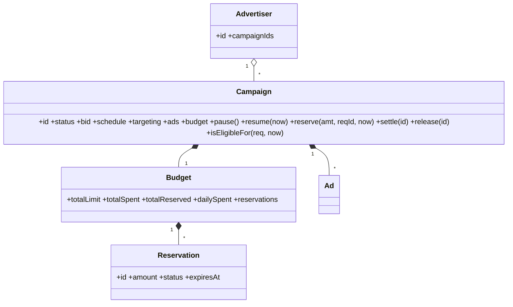
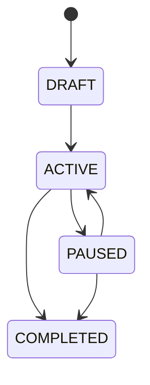

# AdServe — OOAD (v1 first draft, review target)

> Status: first-pass design written directly from the problem statement. Kept unchanged so the review's section references stay valid. The revised design is `AD_SERVE_OOAD.md`.

## 1. Scope and assumptions

- Modular monolith. Java 21, Spring Boot 3, PostgreSQL, Redis, Kafka.
- CPC billing: reserve the bid at serve time, settle on click, release unused reservations after a 30-minute TTL.
- Money is stored as `long` minor units (paise). Single currency (INR).

## 2. Requirements → use cases

| Requirement | Use case | Design elements |
|---|---|---|
| A: create / update / pause / resume / end campaigns | UC1 CreateCampaign, UC2 UpdateCampaign, UC3 PauseCampaign, UC4 ResumeCampaign, UC5 EndCampaign | `Campaign`, `CampaignFactory`, `CampaignRepository` |
| A: budgets, schedule, targeting | UC1, UC2 | `Budget`, `CampaignSchedule`, `TargetingRules` |
| B: eligibility, ranking, no-fill | UC6 ServeAd | `EligibilityFilter` chain, `RankingStrategy`, `AdDecision` |
| C: impressions, clicks, CTR | UC7 RecordImpression, UC8 RecordClick, UC9 GetAnalytics | `AdEvent`, `AnalyticsReadModel` |
| D: caching, reservations, idempotency | UC10 ExpireReservations | `CachingCampaignRepository`, `Reservation`, outbox |

## 3. Domain model

| Type | Kind | Responsibility |
|---|---|---|
| `Advertiser` | Aggregate root | Owns campaigns (holds `List<CampaignId>`), name, contact email |
| `Campaign` | Aggregate root | id, advertiserId, name, status, schedule, bid, targeting, `List<Ad>`, `Budget` |
| `Ad` | Entity | format, headline, creativeUrl, destinationUrl |
| `Budget` | Entity inside `Campaign` | totalLimit, dailyLimit, totalSpent, totalReserved, dailySpent, `List<Reservation>` |
| `Reservation` | Entity inside `Budget` | id, amount, requestId, status (RESERVED / SETTLED / RELEASED), expiresAt |
| `CampaignSchedule`, `TargetingRules`, `Money`, `Bid` | Value objects | Immutable, self-validating |
| `AdDecision` | Value object | Selected ad plus ranking explanation |
| `AdEvent` | Entity | eventId, type (IMPRESSION / CLICK), campaignId, adId, requestId, occurredAt |

**Statuses:** DRAFT, ACTIVE, PAUSED, COMPLETED, EXHAUSTED.

**Invariants**
1. Name non-blank, bid > 0, budget > 0, end > start.
2. `spent + reserved <= totalLimit`.
3. Only ACTIVE campaigns inside their schedule can serve.
4. A campaign cannot be resumed if expired or EXHAUSTED.
5. `dailySpent` is reset to zero at midnight by a scheduled job.

**Behavior:** `activate()`, `pause()`, `resume(now)`, `complete()`, `reserve(amount, requestId, now)`, `settle(reservationId)`, `release(reservationId)`, `isEligibleFor(request, now)`.

## 4. Aggregates and repositories

- `Campaign` is the single aggregate for configuration and money, so every budget change is protected by one consistency boundary.
- JPA `@Version` provides optimistic locking. On `OptimisticLockException` the use case retries up to 3 times.
- `CampaignRepository`: `findById`, `findActiveCandidates(format, region, keywords)`, `save`.
- `AdvertiserRepository`: `findById`, `save`.

## 5. Patterns

| Pattern | Where |
|---|---|
| Strategy | `RankingStrategy` (default: `BidTimesRelevance`) |
| Chain of Responsibility | `StatusFilter → ScheduleFilter → TargetingFilter → BudgetFilter` |
| Specification | `TargetingSpecification` composed with `and()` / `or()` |
| Factory | `CampaignFactory` |
| Decorator | `CachingCampaignRepository` wraps `JpaCampaignRepository` |
| Domain events + Observer | `CampaignPaused`, `CampaignBudgetExhausted`, `AdServed`, `AdClicked` |
| Transactional outbox | All domain events |
| CQRS | Analytics read model separate from write model |
| Anti-corruption layer | Between Campaign and Serving contexts |
| Circuit breaker | Redis and Kafka calls (Resilience4j) |

## 6. Architecture

Clean Architecture per context: `domain` ← `application` ← `infrastructure` / `api`. Domain code has no Spring dependency. Contexts: `campaign`, `serving`, `tracking`, `analytics`, `shared`.

## 7. Serving flow (UC6)

1. Validate the request.
2. `CachingCampaignRepository.findActiveCandidates(format, region, keywords)`:
   - Redis lookup per keyword key `cand:{format}:{region}:{keyword}`, TTL 60 s, value = serialized `Campaign` JSON.
   - Results are unioned and de-duplicated.
   - On a miss, query PostgreSQL.
3. Run the eligibility chain on each candidate.
4. Rank with `RankingStrategy`: `score = bid * relevance`, where `relevance = matchedKeywords / campaign.keywords.size` (double). Tie-break: campaignId.
5. Take the top candidate and load it by id (`campaignRepository.findById`).
6. Call `campaign.reserve(bid, requestId, now)`, which checks only the budget, then `save` (optimistic lock, retry ≤ 3). If it fails, try the next candidate.
7. Write Redis key `served:{requestId}` = `{adId, campaignId}` with a 30-minute TTL.
8. Append `AdServed` to the outbox in the same transaction as step 6.
9. Return FILLED with the ad, or NO_FILL.

## 8. Budget management

- Reserve the bid on serve. Settle on click. A scheduled job runs every minute, loads campaigns with expired reservations, and calls `release` per campaign.
- Concurrency control is optimistic locking on `Campaign`.
- `BudgetSettlementConsumer` consumes `AdClicked` from Kafka and calls `campaign.settle(reservationId)`.
- A midnight job resets `dailySpent` for all campaigns.
- When `reserve` leaves insufficient funds, the campaign moves to EXHAUSTED and emits `CampaignBudgetExhausted`.

## 9. Cache design

- Cache-aside on candidates, TTL 60 s.
- On `CampaignPaused`, `CampaignUpdated`, or `CampaignBudgetExhausted`, an event handler deletes the keys for that campaign's keywords.
- Domain events travel through the outbox, a relay, and Kafka before the cache handler runs.

## 10. Events and reliability

- One topic, `adserve.events` (12 partitions), key = `eventId`.
- Outbox table, polled by a relay every 500 ms.
- Consumers: `AnalyticsConsumer`, `BudgetSettlementConsumer`, `CacheInvalidationConsumer`.
- Idempotency: `processed_events(event_id PK)` is written in the same transaction as the side effect.
- Retries: 3 attempts, then a dead-letter topic.

## 11. API

| Endpoint | Request | Response |
|---|---|---|
| `POST /api/v1/campaigns` | name, bid, budgets, schedule, targeting, ads | 201 campaign |
| `GET /api/v1/campaigns/{id}` | | 200 campaign |
| `POST /api/v1/campaigns/{id}/pause` and `/resume` | | 200 |
| `POST /api/v1/ads/serve` | publisherId, requestId, pageUrl, keywords, region, adFormat | `{requestId, status, ad{id, campaignId, headline, creativeUrl, clickUrl}}` |
| `POST /api/v1/events/impressions` | `{eventId, requestId, adId, campaignId}` | 200 |
| `POST /api/v1/events/clicks` | `{eventId, requestId, adId, campaignId}` | 200 |
| `GET /api/v1/campaigns/{id}/analytics` | | `{impressions, clicks, ctr}` |

Errors: `{error, message}`. 400 for validation, 404 for not found, 409 for invalid transition.

## 12. Persistence

| Table | Notes |
|---|---|
| `campaigns` | JPA entity, `@Version`, targeting as JSONB |
| `campaign_keywords` | campaign_id, keyword (indexed) |
| `ads` | child of campaign |
| `campaign_budgets` | totals and daily counters |
| `reservations` | child of budget |
| `outbox` | event_id, payload, published flag |
| `processed_events` | event_id PK |
| `campaign_stats` | campaign_id PK, impressions, clicks |

Mapping: MapStruct between the JPA entities and the domain objects.

## 13. UML

## 14. TDD roadmap

- Phase 1: `CampaignTest`: `pause_setsStatusToPaused`, `resume_afterEnd_throws`, `reserve_whenInsufficient_throws`.
- Phase 2: `EligibilityChainTest` (each filter), `RankingStrategyTest`, `CampaignRepositoryAdapterTest` (verifies the generated SQL).
- Phase 3: `ServeAdUseCaseTest` with Mockito: `verify(cache).find(...)`, `verify(campaignRepository).save(campaign)`, `verify(outbox).append(any(AdServed.class))` in order.
- Phase 4: `ConcurrentReserveTest` with 50 threads calling `campaign.reserve` on one in-memory object.
- Phase 5: Testcontainers tests for Redis and Kafka; `OutboxRelayTest` verifies `kafkaTemplate.send` is called.
- Phase 6: load test with k6.
