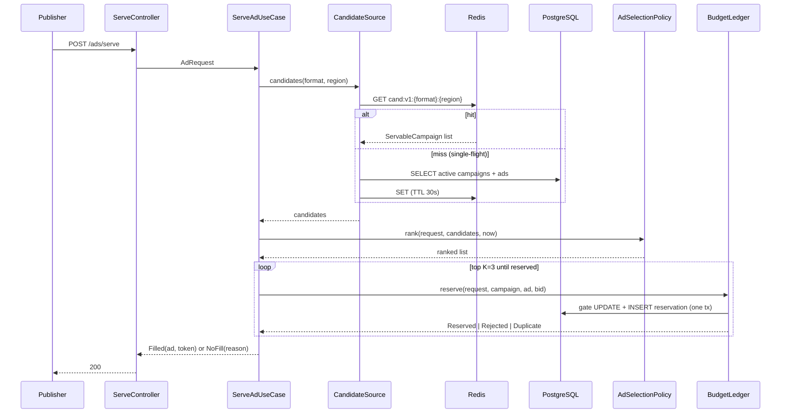
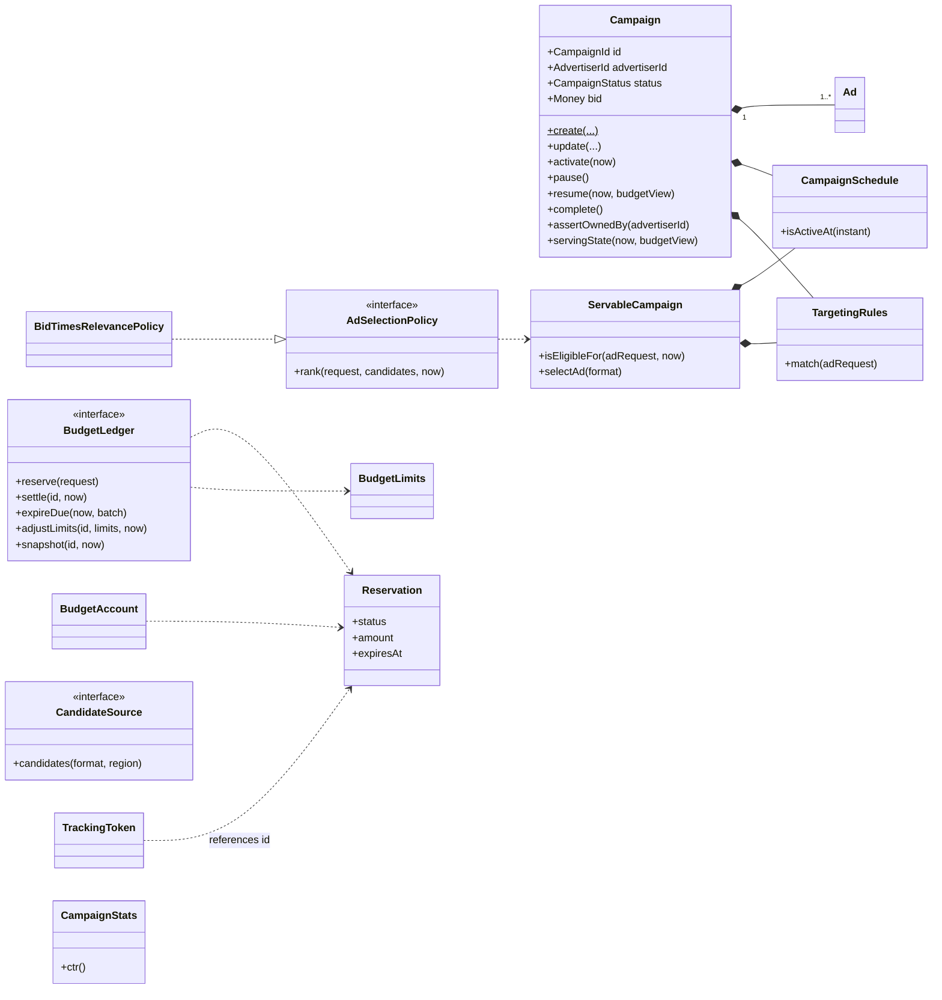
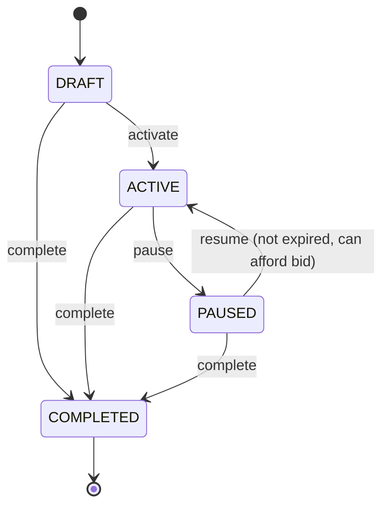
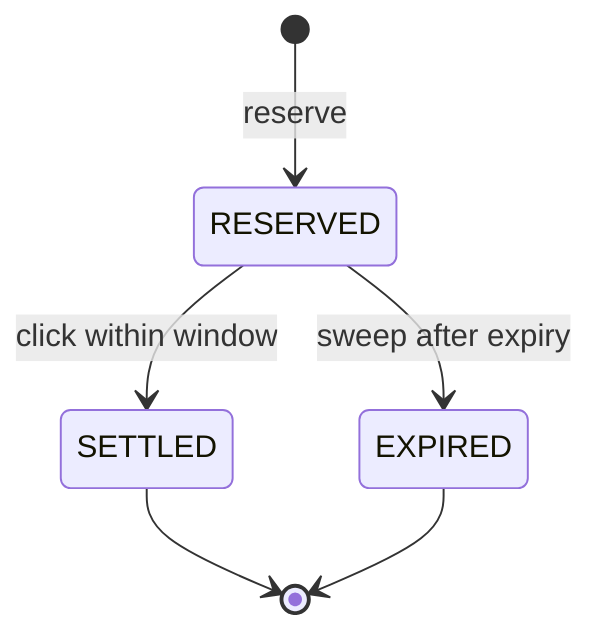
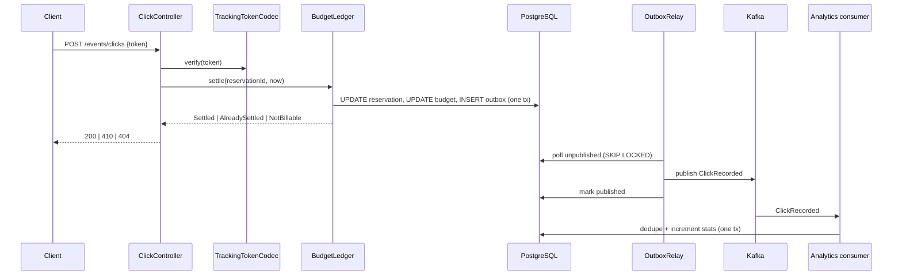

# AdServe — Object-Oriented Analysis and Design (v2, post-review)

> **Status:** revised after `AD_SERVE_DESIGN_REVIEW.md` (findings R-01 … R-27). The first draft is preserved as `AD_SERVE_OOAD_v1_draft.md`.
> **Not yet validated:** no SQL in this document has been executed and no latency figure is measured. The latency table in §6.2 is an estimate to be verified by load tests (PRF-01).

---

## 0. Summary of changes from v1

| Review finding | Change | Section |
|---|---|---|
| R-01, R-03, R-06, R-07 | Budget moved out of `Campaign` into a separate **budget ledger** (counters and reservation rows) changed only by atomic conditional SQL. Click settlement is synchronous. Lazy UTC-day rollover replaces the midnight job. Reservation TTL is configurable, default 10 min. | §4, §7 |
| R-02, R-10 | The reservation statement itself checks campaign status and schedule. Caches are hints only and correctness never depends on invalidation. | §7, §8 |
| R-04, R-18 | Signed tracking token, deterministic event ids, `(publisher_id, request_id)` uniqueness on serve. | §9 |
| R-05 | Persisted statuses reduced to DRAFT, ACTIVE, PAUSED, COMPLETED. Exhaustion is a derived `servingState`. | §4.4 |
| R-08, R-09 | Serving read model `ServableCampaign`; one Redis value per (format, region); one DB transaction per serve. | §6, §8 |
| R-11, R-12 | Outbox for the click event only; impressions published directly; no campaign events on Kafka. | §9 |
| R-13, R-14, R-19, R-25 | Full traceability matrix, advertiser authorization, complete API and error catalog, dependency failure matrix. | §2, §6.4, §10 |
| R-15, R-16, R-26 | Patterns pruned; `Advertiser` aggregate and `Bid` dropped. | §4, §11 |
| R-17 | Integer ranking formula with a full tie-break chain. | §6.3 |
| R-20, R-21, R-22, R-27 | UML and persistence regenerated; `Clock` injected. | §5, §12, §13 |
| R-23, R-24 | Behavior-level test strategy with contract and concurrency tests. | §14 |

**Deliberate deviations from the problem statement's suggested model**

1. `Budget` is not inside `Campaign`; it is a separate ledger (the statement itself allows this: "give them an explicit model and ownership").
2. `Advertiser` is an `AdvertiserId` value object taken from the authenticated principal, not an aggregate.
3. Two endpoints are added: `PUT /campaigns/{id}` (update) and `POST /campaigns/{id}/complete` (end), because Module A requires update and end.
4. Redis caches a serving read model, not the `Campaign` aggregate.

---

## 1. Scope, assumptions, decisions

**Stack:** Java 21, Spring Boot 3, PostgreSQL, Redis, Kafka. Modular monolith.

**Assumptions** (confirm with product; each is a configuration value or a single point of change)

| ID | Assumption | Default |
|---|---|---|
| A1 | Billing is CPC. The charge equals the bid snapshotted at serve time. | — |
| A2 | Single currency (INR). Money is `long` minor units (paise). | — |
| A3 | "Day" for the daily budget is the UTC calendar day. | UTC |
| A4 | Attribution window equals the reservation TTL. | 10 min |
| A5 | An impression is reported by the client when the ad renders. The server cannot verify display, only that the serve was real. | — |
| A6 | Late clicks (after the window) are rejected and not charged. | — |

**Decision log**

| # | Decision | Why | Rejected alternative |
|---|---|---|---|
| D1 | PostgreSQL is the only authority for budget and serve attribution. | Problem statement; Redis can be lost. | Redis counters |
| D2 | One atomic conditional `UPDATE` guards funds and campaign eligibility. | Closes the stale-cache hole with one round trip. | Optimistic locking on the aggregate (retry storms) |
| D3 | Strict reservation of the full bid. | NFR: never overspend. | Expected-cost reservation (bounded overspend) |
| D4 | Settle clicks synchronously. | Billing must not depend on Kafka lag or a DLT. | Async settlement consumer |
| D5 | Outbox only for `ClickRecorded`. | It is the only event that must be atomic with a DB state change. | Outbox for everything |
| D6 | Serving never touches Kafka. | Satisfies business rule 9 by construction. | Publishing `AdServed` |
| D7 | In-process, after-commit cache eviction. | Correctness does not depend on it, so a simple mechanism suffices. | Eviction via Kafka |

---

## 2. Requirements traceability

IDs: **FR-xy** from problem statement module bullets, **NFR-n** from the NFR table, **BR-n** from the core business rules. Test IDs refer to the catalog in §14.3.

### 2.1 Use cases

| UC | Name | Actor |
|---|---|---|
| UC-01 | CreateCampaign | Advertiser |
| UC-02 | UpdateCampaign | Advertiser |
| UC-03 | ActivateCampaign | Advertiser |
| UC-04 | PauseCampaign | Advertiser |
| UC-05 | ResumeCampaign | Advertiser |
| UC-06 | CompleteCampaign | Advertiser |
| UC-07 | GetCampaign | Advertiser |
| UC-08 | ServeAd | Publisher |
| UC-09 | RecordImpression | Publisher client |
| UC-10 | RecordClick | Publisher client |
| UC-11 | ApplyTrackingEvent | Kafka consumer |
| UC-12 | GetCampaignAnalytics | Advertiser |
| UC-13 | ExpireReservations | Scheduler |
| UC-14 | RelayOutbox | Scheduler |
| UC-15 | EvictCandidateCache | Internal (after commit) |
| OPS-01 | Health and metrics | Operator |

### 2.2 Matrix

| Req | Use case | Design element | Tests |
|---|---|---|---|
| FR-A1 create, update, pause, resume, end | UC-01…UC-06 | `Campaign`, `CampaignService` use cases | CMP-01, CMP-03, CMP-04, CMP-07 |
| FR-A2 daily and total budgets | UC-01, UC-02 | `BudgetLimits`, `BudgetLedger.adjustLimits` | CMP-02, CMP-08, BUD-03 |
| FR-A3 start/end dates | UC-01, UC-02 | `CampaignSchedule` | CMP-02, ELG-01 |
| FR-A4 keywords, regions, audience | UC-01, UC-02 | `TargetingRules` | ELG-02, ELG-03, ELG-04 |
| FR-A5 reject invalid transitions and configs | UC-01…UC-06 | `Campaign` guards, `InvalidStateTransition` | CMP-02, CMP-03 |
| FR-B1 match keywords and categories | UC-08 | `TargetingRules.match` | ELG-02, ELG-05 |
| FR-B2 filter by status, schedule, targeting, budget | UC-08 | `ServableCampaign.isEligibleFor`, reservation gate | ELG-01…ELG-04, SRV-05, SRV-06, BUD-04 |
| FR-B3 rank with defined formula | UC-08 | `AdSelectionPolicy`, `BidTimesRelevancePolicy` | RNK-01, RNK-02, RNK-03 |
| FR-B4 best ad or meaningful no-fill | UC-08 | `ServeOutcome` (`Filled`, `NoFill(reason)`) | SRV-01, SRV-02, SRV-03, SRV-07 |
| FR-B5 fallback when dependencies fail | UC-08 | `CandidateSource` fallback, circuit breaker | SRV-08, SRV-09, SRV-10, PRF-02 |
| FR-C1 impression when displayed | UC-09 | `TrackingToken`, `ImpressionRecorded` | TRK-01, TRK-05, TRK-06 |
| FR-C2 click on valid served ad | UC-10 | `BudgetLedger.settle`, token | TRK-01…TRK-03, BUD-05, BUD-07 |
| FR-C3 prevent duplicate processing | UC-10, UC-11 | Deterministic event id, settle state guard, `processed_events` | TRK-04, ANL-03 |
| FR-C4 impressions, clicks, CTR | UC-12 | `CampaignStats`, `campaign_daily_stats` | ANL-01, ANL-02, ANL-06 |
| FR-C5 async via Kafka | UC-09, UC-11, UC-14 | `tracking.v1` topic, outbox relay, consumer | TRK-07, TRK-08, ANL-04, ANL-05 |
| FR-D1 cache in Redis | UC-08 | `RedisCandidateCache` | SRV-08, CCH-02 |
| FR-D2 invalidate/refresh on change | UC-15 | After-commit eviction, TTL, reservation gate | CCH-01, SRV-05 |
| FR-D3 concurrent reservations safe | UC-08, UC-10, UC-13 | Atomic ledger SQL, CHECK constraints | BUD-11, BUD-12, BUD-13 |
| FR-D4 timeouts, retries, idempotent consumers | UC-08, UC-11, UC-14 | Timeouts per dependency, error handler, dedupe | SRV-09, ANL-03, ANL-05, PRF-02 |
| FR-D5 health and metrics | OPS-01 | Actuator indicators, Micrometer | OPS-03, OPS-04 |
| NFR-1 p95 < 100 ms | UC-08 | §6 serve path | PRF-01 |
| NFR-2 controlled no-fill | UC-08 | `NoFill(reason)` | SRV-01, SRV-07, SRV-09 |
| NFR-3 never overspend | UC-08, UC-10, UC-13 | §7 | BUD-01, BUD-02, BUD-11, BUD-12 |
| NFR-4 at-least-once + idempotent | UC-10, UC-11, UC-14 | §9 | TRK-08, ANL-03, ANL-04 |
| NFR-5 domain testable without infrastructure | all | Pure domain, in-memory fakes | OPS-01 |
| NFR-6 business rules isolated | all | Layering, ArchUnit | OPS-01, OPS-02 |
| NFR-7 authenticated, advertiser-level access | UC-01…UC-07, UC-12 | `assertOwnedBy`, principal | CMP-09, OPS-05 |
| BR-1 valid name, bid, budget, schedule | UC-01 | `Campaign.create`, `BudgetLimits` | CMP-02 |
| BR-2 not before start or after end | UC-08 | `CampaignSchedule.isActiveAt` | ELG-01 |
| BR-3 paused or completed never serves | UC-08 | Reservation gate | SRV-05, BUD-04 |
| BR-4 insufficient budget → ineligible | UC-08 | Reservation gate | BUD-01, BUD-02, SRV-04 |
| BR-5 click needs previous serve in window | UC-10 | Token + reservation state | TRK-02, TRK-03, BUD-07 |
| BR-6 same event id never counts twice | UC-10, UC-11 | §9.4 | TRK-04, ANL-03 |
| BR-7 no resume if expired or exhausted | UC-05 | `Campaign.resume(now, BudgetView)` | CMP-05, CMP-06 |
| BR-8 deterministic ranking | UC-08 | §6.3 tie-break chain | RNK-03 |
| BR-9 analytics failure never fails a serve | UC-08 | Serving has no Kafka dependency | SRV-10 |
| BR-10 concurrent requests never over-reserve | UC-08 | §7 | BUD-11 |

---

## 3. Contexts and package structure

```text
com.adserve
├── campaign      domain · application · infrastructure (JPA) · api
├── budget        domain · application · infrastructure (JDBC SQL)
├── serving       domain · application · infrastructure (Redis, JDBC read model) · api
├── tracking      domain · application · infrastructure (HMAC token, Kafka, outbox) · api
├── analytics     domain · application · infrastructure (Kafka consumer, JDBC) · api
└── shared        Money, ids, AdFormat, Clock, published value objects
```

**Dependency rules** (enforced by ArchUnit, OPS-01 and OPS-02)

- `domain` depends on nothing but the JDK and `shared`.
- `application` depends on its own `domain`, plus `shared` and the published ports of other contexts (`BudgetLedger`, `CampaignRepository` where needed).
- `infrastructure` and `api` depend inward.
- Contexts talk to each other only through ports declared in `domain` or `application`. No context imports another's `infrastructure`.
- The single intentional cross-context data dependency is the ledger SQL reading `campaigns` (§7.2).

---

## 4. Domain model

### 4.1 Objects and responsibilities

| Type | Context | Kind | Identity | Responsibility |
|---|---|---|---|---|
| `Campaign` | campaign | Aggregate root | `CampaignId` | Config and lifecycle: name, bid, schedule, targeting, ads, status. Owns every state transition. |
| `Ad` | campaign | Entity (inside `Campaign`) | `AdId` | Format, headline, creative URL, destination URL. |
| `CampaignSchedule` | shared | Value object | — | `startAt` inclusive, `endAt` exclusive; `isActiveAt(Instant)`. |
| `TargetingRules` | shared | Value object | — | Keywords, categories, regions, audience segments. `match(AdRequest)` returns matched term count or no match. |
| `Money` | shared | Value object | — | `long minor`, currency. Non-negative arithmetic. |
| `BudgetLimits` | budget | Value object | — | Total and daily limits, both positive, daily ≤ total. |
| `BudgetAccount` | budget | Pure domain class | `CampaignId` | Executable specification of the ledger invariants (§7.1). Used by the in-memory ledger and contract tests. |
| `Reservation` | budget | Record | `ReservationId` | One serve: campaign, ad, publisher, request id, amount, day, status, expiry, ad snapshot. |
| `BudgetView` | budget | Value object | — | Read-only snapshot: remaining total, remaining daily; `canAfford(Money)`. |
| `ServableCampaign` | serving | Immutable read model | `CampaignId` | Flat projection used for selection. `isEligibleFor(AdRequest, Instant)`, `selectAd(AdFormat)`. |
| `AdRequest` | serving | Value object | — | Validated request: publisher, request id, keywords, categories, region, format, segments. |
| `AdSelectionPolicy` | serving | Domain service (interface) | — | Filters and ranks candidates; replaceable. |
| `TrackingToken` | tracking | Value object | — | Reservation, campaign, ad, publisher, expiry. Signed and verified by `TrackingTokenCodec`. |
| `ImpressionRecorded`, `ClickRecorded` | tracking | Immutable events | deterministic `eventId` | Facts about a served ad. |
| `CampaignStats` | analytics | Value object | — | Impressions, clicks, `ctr()`. |

**Identity vs value:** ids, `Campaign`, `Ad`, and `Reservation` have identity. Everything else is an immutable value object.

### 4.2 Aggregates and invariants

**`Campaign` aggregate** (config and lifecycle only; low-contention writes; optimistic locking via `@Version`)

- I-C1. Name is non-blank; bid > 0; `endAt > startAt`.
- I-C2. At least one keyword or category in targeting. Every ad has a valid format and HTTPS URLs.
- I-C3. Status changes only through behavior methods. There is no `setStatus`.
- I-C4. A COMPLETED campaign is immutable.
- I-C5. Ads belong to exactly one campaign and are edited only through it.

**Budget ledger** (the unit of consistency is one budget row plus its reservation rows; changed only by single-statement atomic SQL, never loaded as an object graph)

- I-B1. `totalSpent + totalReserved <= totalLimit` at all times.
- I-B2. For the current ledger day, `dailySpent + dailyReserved <= dailyLimit`.
- I-B3. A reservation moves `RESERVED → SETTLED` or `RESERVED → EXPIRED` exactly once; counters move exactly once per transition.
- I-B4. Settlement charges exactly the reserved amount.
- I-B5. A reservation is created only if the campaign is ACTIVE and inside its schedule at that instant.

**Why money is not in `Campaign`:** reservations happen on every serve; pausing or editing a campaign must not contend with them, and an aggregate that accumulates one reservation per serve is unbounded (R-01).

### 4.3 Where each decision lives

| Question from the problem statement | Answer |
|---|---|
| Which object owns state transitions? | `Campaign` (`activate`, `pause`, `resume`, `complete`). |
| `setStatus()` or behavior methods? | Behavior methods only. |
| Is `Budget` a value object? | No. `BudgetLimits` is a value object; the ledger holds the counters. |
| Where does ranking live? | `AdSelectionPolicy` (serving domain). |
| How is the policy replaced? | `ServeAdUseCase` depends on the interface; the default is `BidTimesRelevancePolicy`. |
| Which dependencies are interfaces? | `CampaignRepository`, `BudgetLedger`, `CandidateSource`, `AdSelectionPolicy`, `EventPublisher`, `TrackingTokenCodec`, `StatsRepository`, `Clock`. |

### 4.4 Campaign lifecycle

Persisted statuses: **DRAFT, ACTIVE, PAUSED, COMPLETED**.

| From | Action | To | Guards |
|---|---|---|---|
| DRAFT | `activate(now)` | ACTIVE | `endAt > now` |
| ACTIVE | `pause()` | PAUSED | — |
| PAUSED | `resume(now, budgetView)` | ACTIVE | `endAt > now` (BR-7); `budgetView.canAfford(bid)` (BR-7) |
| DRAFT / ACTIVE / PAUSED | `complete()` | COMPLETED | — |

Everything else raises `InvalidStateTransition`.

**Derived `servingState`** (for display only; never persisted): `DRAFT`, `PAUSED`, `COMPLETED`, `NOT_STARTED`, `EXPIRED`, `BUDGET_EXHAUSTED`, `DAILY_CAP_REACHED`, `SERVING`. Computed by `campaign.servingState(now, budgetView)`.

**Resume spans two aggregates.** `ResumeCampaignUseCase` reads `ledger.snapshot(id)` and passes the resulting `BudgetView` into `campaign.resume`. A concurrent settlement between the read and the save is harmless, because the reservation gate still enforces funds (§7.2).

---

## 5. Architecture

Clean Architecture per context: `api → application → domain ← infrastructure`.

| Layer | Contains | Must not contain |
|---|---|---|
| domain | Entities, value objects, domain services, port interfaces, domain events | Spring, JPA, Jackson, Redis, Kafka, JDBC |
| application | Use cases (transaction and orchestration), command objects | Business rules (rules live in domain) |
| infrastructure | JPA mapping, JDBC SQL, Redis, Kafka, HMAC, outbox | Business decisions beyond what the SQL expresses |
| api | Controllers, DTOs, problem-details mapping, authentication | Domain logic |

**SOLID check**

- SRP: ledger (money), selection policy (ranking), token codec (signing), cache (hints) are separate.
- OCP: new ranking strategies implement `AdSelectionPolicy`.
- LSP: the in-memory and Postgres ledgers are interchangeable, proven by one contract test suite (§14.2).
- ISP: separate small ports (`CandidateSource` is read-only; `BudgetLedger` is split into reserve/settle/expire/admin methods).
- DIP: use cases depend on ports.

**Persistence mapping:** JPA entities exist only for `Campaign` and `Ad`, with hand-written mappers (about 60 lines) covered by a round-trip test. The ledger, serving read model, tracking, and analytics use `JdbcTemplate`.

---

## 6. Serving path (UC-08)

### 6.1 Algorithm



1. Validate `AdRequest` (publisher key matches `publisherId`, region format, ≤ 50 keywords, format known). Failure is `400`.
2. `CandidateSource.candidates(format, region)`: Redis, then a single-flight DB load on miss (§8). If both fail, return `NoFill(TEMPORARILY_UNAVAILABLE)`.
3. `AdSelectionPolicy.rank` keeps candidates where `isEligibleFor(request, now)` is true and orders them (§6.3).
4. For up to **K = 3** top candidates, call `ledger.reserve(...)`.
   - `Reserved` → build the token and return `Filled`.
   - `Rejected` → try the next candidate (stale snapshot, paused campaign, or insufficient funds).
   - `Duplicate` → return the original ad from the stored snapshot (same `requestId`).
5. If no candidate reserved: `NoFill(BUDGET_UNAVAILABLE)` when there were ranked candidates, otherwise `NoFill(NO_ELIGIBLE_CAMPAIGN)`.

The serving path never publishes to Kafka, never writes to Redis except on a cache refill, and never writes to the `campaigns` table.

### 6.2 Latency budget (estimates to be validated by PRF-01)

| Step | Typical | Notes |
|---|---|---|
| Redis GET + deserialize | 1–4 ms | Grows with candidates per (format, region) |
| Eligibility + ranking (in memory) | < 2 ms | Integer arithmetic |
| Reservation transaction | 3–8 ms | Gate UPDATE, INSERT, commit |
| Token signing | < 0.1 ms | HMAC-SHA256 |
| **Total** | **~10–15 ms** | Target: p95 < 100 ms |

**DB round trips per serve:** 2 statements in 1 transaction on the normal path. A rejected top candidate costs one extra single-statement round trip (no insert). **Cache miss:** 1 DB query, shared by all concurrent requests for that key.

### 6.3 Ranking (BR-8)

- `matchedTerms = |request.keywords ∩ rules.keywords| + |request.categories ∩ rules.categories|`. All terms are normalized to lowercase and trimmed.
- `requestTerms = |request.keywords| + |request.categories|` (distinct).
- A candidate is eligible only if `matchedTerms ≥ 1`.
- `relevanceBp = 10_000 × matchedTerms / requestTerms` (integer division).
- `score = bidMinor × relevanceBp` (`long`; overflow guarded by `Math.multiplyExact`).

**Order:** `score` desc, then `relevanceBp` desc, then `bidMinor` desc, then `campaignId` asc, then `adId` asc.

Within a campaign, the ad is the lowest `adId` among ads matching the requested format.

**Why irrelevant high bids do not always win:** relevance multiplies the bid. A bid of 30 at relevance 0.10 scores 3.0 and loses to a bid of 10 at relevance 0.50 (5.0).

**Eligibility rules** in `ServableCampaign.isEligibleFor`:

- `schedule.isActiveAt(now)`.
- Region: empty rules allow all; a rule `IN` matches request `IN-KA`; a rule `IN-KA` matches only `IN-KA`.
- Audience: empty rules allow all; otherwise at least one request segment must match.
- At least one ad matches the requested format.
- `matchedTerms ≥ 1`.

Status and funds are **not** evaluated here; the reservation gate is their authority (§7.2).

### 6.4 Dependency failure matrix (FR-B5, FR-D4, R-25)

| Dependency | Timeout | Failure behavior | Serving impact |
|---|---|---|---|
| Redis | 30 ms | Circuit breaker opens; load candidates from DB with a concurrency cap of 10 | Slightly slower, still correct |
| PostgreSQL (candidates) | 200 ms | `NoFill(TEMPORARILY_UNAVAILABLE)` | No ad |
| PostgreSQL (reserve) | 200 ms | Treat as failure for that attempt; stop and `NoFill(TEMPORARILY_UNAVAILABLE)` | No ad |
| Kafka | n/a | Not on the serving path | None |
| Kafka (impression endpoint) | 300 ms | `503 EVENT_BUS_UNAVAILABLE` so the client retries | None for serving |
| Kafka (click outbox relay) | — | Rows remain unpublished and are retried | None |

A DB timeout on `reserve` is ambiguous (the transaction may have committed). That is safe, because the reservation expires and releases funds, and a publisher retry with the same `requestId` returns the existing reservation.

---

## 7. Budget ledger

### 7.1 Model

`BudgetLedger` is the domain port. Its two implementations:

- `PostgresBudgetLedger` (production): single-statement atomic SQL.
- `InMemoryBudgetLedger` (test fixture): built on `BudgetAccount`, a pure class that is the executable specification.

Both pass the same contract suite (BUD-01 … BUD-10). `BUD-11 … BUD-13` run on PostgreSQL only.

```java
public interface BudgetLedger {
    ReservationResult reserve(ReservationRequest request);          // Reserved | Rejected | Duplicate
    SettlementResult  settle(ReservationId id, Instant now);        // Settled | AlreadySettled | NotBillable(reason)
    int               expireDue(Instant now, int batchSize);        // releases funds of expired reservations
    LimitChangeResult adjustLimits(CampaignId id, BudgetLimits limits, Instant now);
    void              open(CampaignId id, BudgetLimits limits);     // create account (same tx as campaign create)
    BudgetView        snapshot(CampaignId id, Instant now);
}
```

**Reservation amount** = the campaign's current bid, snapshotted on the reservation. Later bid changes do not affect existing reservations.

### 7.2 Reserve (the gate)

```sql
-- Statement 1: gate. Zero rows means Rejected (nothing was written).
UPDATE budget_accounts b SET
  total_reserved = b.total_reserved + :amt,
  daily_day      = :today,
  daily_spent    = CASE WHEN b.daily_day = :today THEN b.daily_spent    ELSE 0 END,
  daily_reserved = CASE WHEN b.daily_day = :today THEN b.daily_reserved ELSE 0 END + :amt
FROM campaigns c
WHERE b.campaign_id = :campaignId
  AND c.id = b.campaign_id
  AND c.status = 'ACTIVE' AND c.start_at <= :now AND c.end_at > :now
  AND b.total_spent + b.total_reserved + :amt <= b.total_limit
  AND (CASE WHEN b.daily_day = :today THEN b.daily_spent + b.daily_reserved ELSE 0 END) + :amt <= b.daily_limit;

-- Statement 2 (same transaction, only if statement 1 updated a row):
INSERT INTO reservations (id, campaign_id, ad_id, publisher_id, request_id, amount, day, status,
                          created_at, expires_at, ad_snapshot)
VALUES (:id, :campaignId, :adId, :publisherId, :requestId, :amt, :today, 'RESERVED', :now, :expiresAt, :snapshot);
-- On unique violation (publisher_id, request_id): roll back the transaction
-- (undoing statement 1), load the existing reservation, return Duplicate.
```

**Why this is safe**

- Under `READ COMMITTED`, a concurrent `UPDATE` on the same budget row waits for the row lock, then re-evaluates its `WHERE` clause against the latest committed row version. Two requests cannot both pass a check that only one can afford.
- `CHECK` constraints (§12) reject any write that breaks I-B1 or I-B2, even if the SQL is wrong.
- The row lock is held from statement 1 until commit (about 2 ms). Per-campaign throughput is therefore bounded to a few hundred reservations per second. This is acceptable for the initial design (§15).

**Documented race (accepted):** the `campaigns` row is read without a lock. A pause that commits within milliseconds of a reservation can lose the race by one ad. Pause means "stop serving new ads soon", not "no ad is in flight".

**Clock:** `:now` and `:today` come from the application `Clock`, not the DB, so tests are deterministic. Multi-node clock skew must be kept below the reservation TTL granularity (NTP).

### 7.3 Settle (click)

```sql
-- One transaction:
UPDATE reservations SET status = 'SETTLED', settled_at = :now
WHERE id = :rid AND status = 'RESERVED' AND expires_at > :now
RETURNING campaign_id, amount, day;
-- 0 rows → look up the row: SETTLED → AlreadySettled; EXPIRED/expired → NotBillable(WINDOW_EXPIRED); absent → NotBillable(UNKNOWN)
-- 1 row:
UPDATE budget_accounts SET
  total_reserved = total_reserved - :amt,
  total_spent    = total_spent    + :amt,
  daily_reserved = CASE WHEN daily_day = :rday THEN daily_reserved - :amt ELSE daily_reserved END,
  daily_spent    = CASE WHEN daily_day = :rday THEN daily_spent    + :amt ELSE daily_spent    END
WHERE campaign_id = :cid;
INSERT INTO outbox (event_id, topic, event_key, payload) VALUES (:rid || ':CLK', 'tracking.v1', :rid, :payload);
```

- **Charge = reserved amount** (I-B4), so a settlement can never exceed what was reserved.
- A second click matches zero rows in the first statement and returns `AlreadySettled` (no charge, no second outbox row).
- If the reservation was made on an earlier day (`:rday` differs from `daily_day`), only the totals move. That charge belongs to a day that has already closed.
- The `outbox` insert is in the same transaction, so a settled click cannot lose its analytics event (D5).

### 7.4 Expiry sweep (UC-13)

Runs every 30 s, batch 1,000, safe to run on every instance concurrently (`SKIP LOCKED`).

```sql
WITH expired AS (
  UPDATE reservations SET status = 'EXPIRED'
  WHERE id IN (SELECT id FROM reservations
               WHERE status = 'RESERVED' AND expires_at <= :now
               ORDER BY expires_at LIMIT :batch FOR UPDATE SKIP LOCKED)
  RETURNING campaign_id, amount, day
)
UPDATE budget_accounts b SET
  total_reserved = b.total_reserved - (SELECT SUM(e.amount) FROM expired e WHERE e.campaign_id = b.campaign_id),
  daily_reserved = b.daily_reserved - COALESCE((SELECT SUM(e.amount) FROM expired e
                                                WHERE e.campaign_id = b.campaign_id AND e.day = b.daily_day), 0)
WHERE b.campaign_id IN (SELECT campaign_id FROM expired);
```

- A click and the sweeper race on the same `status = 'RESERVED'` guard. Exactly one wins (BUD-12), and the counters move once.
- Until the sweeper runs, expired reservations still hold funds. The lag is bounded by the sweep interval.

### 7.5 Limit changes

`adjustLimits` applies the same lazy day rollover and rejects when the new total is below `totalSpent + totalReserved`, or the new daily limit is below the current day's `dailySpent + dailyReserved`.

### 7.6 Reservation TTL trade-off

With strict reservation, a campaign with budget B and bid b can have at most B/b serves outstanding within one TTL window. With a click-through rate around 1–2%, most reserved funds are released unclicked, and delivery is limited accordingly. The TTL is therefore a product decision (A4). Shorter windows increase delivery and reject more late clicks.

---

## 8. Cache design (FR-D1, FR-D2)

**Principle:** the cache narrows the candidate set; it is never the authority. A stale entry can waste one reservation attempt but can never cause an ineligible ad to be served (§7.2).

| Aspect | Design |
|---|---|
| Contents | `List<CachedCandidate>` (infrastructure DTO with `schemaVersion`) mapped to `ServableCampaign` |
| Key | `adserve:cand:v1:{FORMAT}:{REGION}` where `REGION` is the request region. Keys are tracked in the Redis set `adserve:cand:keys`. |
| TTL | 30 s |
| Load on miss | Single-flight: concurrent misses for one key share one DB load (CCH-02) |
| Version mismatch | A DTO with an unknown `schemaVersion` is treated as a miss (CCH-03) |
| Invalidation | `@TransactionalEventListener(AFTER_COMMIT)` on campaign events deletes every key in `adserve:cand:keys` (`UNLINK`). Best-effort. |
| Redis outage | Circuit breaker, then DB candidate query (§6.4) |

**Candidate query** (indexed on `campaigns(status, end_at)`):

```sql
SELECT c.*, a.* FROM campaigns c JOIN ads a ON a.campaign_id = c.id
WHERE c.status = 'ACTIVE' AND c.end_at > :now AND a.format = :format
  AND (cardinality(c.regions) = 0 OR :region = ANY(c.regions) OR :country = ANY(c.regions));
```

**Staleness analysis**

| Event | Worst case | Why it is safe |
|---|---|---|
| Campaign paused | Present in cache ≤ 30 s | Gate rejects it (SRV-05) |
| Campaign ended / schedule passed | Present ≤ 30 s | `isEligibleFor` plus gate (SRV-06) |
| Budget exhausted | Present ≤ 30 s | Gate rejects; costs one cheap statement per request |
| Campaign activated or created | Absent ≤ 30 s | Slightly delayed delivery only |
| Invalidation fails (Redis down) | TTL bounds staleness | Correctness never depended on it |

**Known inefficiency:** a stale exhausted campaign that ranks first is retried on each request until the TTL expires. Add a per-process "recently rejected" hint only if PRF-01 shows it matters.

---

## 9. Tracking and events

### 9.1 Tracking token

`TrackingToken { reservationId, campaignId, adId, publisherId, expiresAt }`, serialized and signed with HMAC-SHA256 (key id `kid` in the header for rotation, constant-time comparison). Returned in the serve response. Clients never send `campaignId`, `adId`, or an event id.

### 9.2 Impression (UC-09)

1. Verify signature and `expiresAt`. Invalid → `400 INVALID_TRACKING_TOKEN`; expired → `410 ATTRIBUTION_WINDOW_EXPIRED`.
2. `eventId = reservationId + ":IMP"`.
3. Publish `ImpressionRecorded` directly to Kafka (idempotent producer, `acks=all`, 300 ms bounded wait). Failure → `503 EVENT_BUS_UNAVAILABLE`.
4. Respond `202`.

There is no outbox because the impression has no database state change to make atomic with the event (D5). Duplicate impressions from client retries share the same `eventId` and are collapsed by the consumer.

### 9.3 Click (UC-10)

1. Verify signature (no expiry check here; the ledger is authoritative).
2. `ledger.settle(reservationId, now)` (§7.3).
3. Respond `200 {status: SETTLED}` or `200 {status: DUPLICATE}`; `410 ATTRIBUTION_WINDOW_EXPIRED` for `NotBillable(WINDOW_EXPIRED)`; `404 SERVE_NOT_FOUND` for `NotBillable(UNKNOWN)`.

A click does not require a prior impression event (TRK-09), because impression beacons can be lost.

### 9.4 Outbox and relay (UC-14)

- Only `ClickRecorded` is written to the outbox, in the settle transaction.
- Relay: every 200 ms, `SELECT … FROM outbox WHERE published_at IS NULL ORDER BY id LIMIT 100 FOR UPDATE SKIP LOCKED`, publish with `send().get(timeout)`, then set `published_at`. Safe to run on every instance.
- A crash between publish and marking republishes the row. Duplicates are expected and tolerated (at-least-once).
- Published rows are deleted after 1 day.

**Is the outbox necessary?** For `ClickRecorded` yes: the settle commit and the event must both happen or neither, or analytics permanently disagrees with billing. The ledger is the billing source of truth either way. An alternative is a reconciliation job comparing `SETTLED` reservations with click counters. The outbox was chosen because it is one table and one small relay, and it makes the analytics counters correct without a reconciliation process.

### 9.5 Kafka topic and consumer

- Topic `tracking.v1`, key = `reservationId`, so a serve's impression and click land on the same partition.
- Producer: `enable.idempotence=true`, `acks=all`.
- Consumer (`ApplyTrackingEvent`, UC-11), one transaction per record:

```sql
INSERT INTO processed_events (event_id, processed_at) VALUES (:eventId, :now) ON CONFLICT DO NOTHING;
-- if one row was inserted:
INSERT INTO campaign_daily_stats (campaign_id, day, impressions, clicks) VALUES (:cid, :day, :i, :c)
ON CONFLICT (campaign_id, day) DO UPDATE
  SET impressions = campaign_daily_stats.impressions + :i, clicks = campaign_daily_stats.clicks + :c;
```

- `day` is the UTC date of the event's `occurredAt`.
- Counters are commutative, so out-of-order delivery gives the same totals (ANL-04).
- Offsets are committed after the database transaction, so a crash redelivers the record and the dedupe absorbs it.
- Errors: exponential backoff, 3 retries, then dead-letter topic `tracking.v1.dlt` with an alert. Malformed payloads go to the DLT immediately and do not block the partition.
- `processed_events` rows older than 7 days are purged (longer than any realistic redelivery).

### 9.6 Delivery guarantees

| Failure | Result |
|---|---|
| Duplicate impression or click delivery | Counted once (deterministic id + `processed_events`) |
| Click double submitted | Charged once (settle guard); one outbox row |
| Kafka down during a click | Click is charged and the outbox row waits; analytics catch up later |
| Kafka down during an impression | Client receives 503 and retries |
| Impression beacon lost | Impression undercounted; CTR can exceed 1 and is reported as is |
| Consumer crash after DB commit | Redelivery absorbed by dedupe |

---

## 10. API contract

All endpoints are under `/api/v1`. Management endpoints require a JWT with an `advertiserId` claim. `/ads/serve` requires a publisher API key (`X-Publisher-Key`); the key's publisher must equal `publisherId` in the body. Event endpoints are authorized by the signed token.

| Method | Path | Purpose | Success |
|---|---|---|---|
| POST | `/campaigns` | Create (UC-01) | `201` + `Location` |
| GET | `/campaigns/{id}` | Read (UC-07) | `200` |
| PUT | `/campaigns/{id}` | Update (UC-02) | `200` |
| POST | `/campaigns/{id}/activate` | UC-03 | `200` |
| POST | `/campaigns/{id}/pause` | UC-04 | `200` |
| POST | `/campaigns/{id}/resume` | UC-05 | `200` |
| POST | `/campaigns/{id}/complete` | UC-06 | `200` |
| POST | `/ads/serve` | UC-08 | `200` |
| POST | `/events/impressions` | UC-09 | `202` |
| POST | `/events/clicks` | UC-10 | `200` |
| GET | `/campaigns/{id}/analytics?from=&to=` | UC-12 | `200` |

### 10.1 Key payloads

**Create / update campaign**

```json
{
  "name": "Monsoon Running Shoes",
  "bidMinor": 1200, "currency": "INR",
  "totalBudgetMinor": 5000000, "dailyBudgetMinor": 500000,
  "startAt": "2026-11-01T00:00:00Z", "endAt": "2026-11-30T00:00:00Z",
  "targeting": { "keywords": ["running","shoes"], "categories": ["sports"],
                 "regions": ["IN-KA","IN-MH"], "audienceSegments": [] },
  "ads": [{ "format": "BANNER", "headline": "Find Your Next Running Shoes",
            "creativeUrl": "https://cdn.example.com/ad-501.png",
            "destinationUrl": "https://example.com/products/shoes" }]
}
```

The response includes `status` and the derived `servingState`, budget limits, and current counters from the ledger.

**Serve request** (as in the problem statement, plus optional `categories` and `audienceSegments`):

```json
{ "publisherId": "pub-101", "requestId": "req-9001", "pageUrl": "https://example.com/running-shoes",
  "keywords": ["running","fitness","shoes"], "categories": ["sports"], "region": "IN-KA",
  "adFormat": "BANNER", "audienceSegments": [] }
```

**Serve response, filled**

```json
{ "requestId": "req-9001", "status": "FILLED",
  "ad": { "id": "ad-501", "campaignId": "cmp-101", "headline": "Find Your Next Running Shoes",
          "creativeUrl": "https://cdn.example.com/ad-501.png",
          "clickUrl": "https://example.com/products/shoes" },
  "tracking": { "token": "eyJ...", "expiresAt": "2026-11-02T10:10:00Z" } }
```

**Serve response, no fill**

```json
{ "requestId": "req-9001", "status": "NO_FILL", "reason": "NO_ELIGIBLE_CAMPAIGN" }
```

`reason` is one of `NO_ELIGIBLE_CAMPAIGN`, `BUDGET_UNAVAILABLE`, `TEMPORARILY_UNAVAILABLE`.

**Impression / click request:** `{ "token": "eyJ..." }`

**Analytics response**

```json
{ "campaignId": "cmp-101", "from": "2026-11-01", "to": "2026-11-07",
  "impressions": 12000, "clicks": 180, "ctr": 0.0150,
  "spentMinor": 216000,
  "daily": [{ "day": "2026-11-01", "impressions": 1700, "clicks": 25 }] }
```

CTR is `clicks / impressions` as a decimal with 4 places (half-even); it is `0` when impressions are `0`. `spentMinor` is read from the ledger.

### 10.2 Errors

Responses use RFC 7807 `application/problem+json` with a stable `code`.

| HTTP | `code` | When |
|---|---|---|
| 400 | `VALIDATION_FAILED` | Bad payload or invalid config (field errors listed) |
| 400 | `INVALID_TRACKING_TOKEN` | Bad signature or malformed token |
| 401 | `UNAUTHENTICATED` | Missing or invalid credentials |
| 403 | `FORBIDDEN` | Publisher key does not match `publisherId` |
| 404 | `CAMPAIGN_NOT_FOUND` | Unknown id **or owned by another advertiser** |
| 404 | `SERVE_NOT_FOUND` | Click for an unknown reservation |
| 409 | `INVALID_STATE_TRANSITION` | Lifecycle guard failed |
| 409 | `CAMPAIGN_NOT_RESUMABLE` | Expired or budget cannot afford one more serve |
| 409 | `BUDGET_BELOW_COMMITTED` | New limit is below spent + reserved |
| 409 | `CONCURRENT_MODIFICATION` | Optimistic lock failure on the campaign |
| 410 | `ATTRIBUTION_WINDOW_EXPIRED` | Impression or click after expiry |
| 503 | `EVENT_BUS_UNAVAILABLE` | Impression could not be published |

`/ads/serve` returns `200` for every business outcome, including `NO_FILL`. Only malformed requests (`400`) and authentication errors fail the HTTP call.

---

## 11. Patterns used (and rejected)

| Pattern | Decision | Reason |
|---|---|---|
| Strategy (`AdSelectionPolicy`) | Keep | Required: replaceable selection policy |
| Repository / ports | Keep | Domain isolation, in-memory fakes |
| Domain events (in-process) | Keep, narrowed | Cache eviction after commit |
| Transactional outbox | Keep, narrowed | Click event only |
| Circuit breaker | Keep | Redis and DB timeouts |
| Static factory (`Campaign.create`) | Keep | Replaces `CampaignFactory` |
| Chain of Responsibility | Rejected | Four predicates in one method |
| Specification | Rejected | `TargetingRules.match` suffices |
| Decorator caching repository | Rejected | Wrong object to cache |
| CQRS / ACL | Rejected as labels | A read model and a counters table are enough |
| Event sourcing, saga, microservices | Rejected | No requirement justifies them |

---

## 12. Persistence

```sql
CREATE TABLE campaigns (
  id uuid PRIMARY KEY, advertiser_id uuid NOT NULL, name text NOT NULL,
  status text NOT NULL CHECK (status IN ('DRAFT','ACTIVE','PAUSED','COMPLETED')),
  bid_minor bigint NOT NULL CHECK (bid_minor > 0), currency char(3) NOT NULL,
  start_at timestamptz NOT NULL, end_at timestamptz NOT NULL CHECK (end_at > start_at),
  keywords text[] NOT NULL DEFAULT '{}', categories text[] NOT NULL DEFAULT '{}',
  regions text[] NOT NULL DEFAULT '{}', audience_segments text[] NOT NULL DEFAULT '{}',
  version bigint NOT NULL, created_at timestamptz NOT NULL, updated_at timestamptz NOT NULL);
CREATE INDEX ix_campaigns_serving ON campaigns (status, end_at);
CREATE INDEX ix_campaigns_advertiser ON campaigns (advertiser_id);

CREATE TABLE ads (
  id uuid PRIMARY KEY, campaign_id uuid NOT NULL REFERENCES campaigns(id),
  format text NOT NULL, headline text NOT NULL, creative_url text NOT NULL, destination_url text NOT NULL);
CREATE INDEX ix_ads_campaign ON ads (campaign_id, format);

CREATE TABLE budget_accounts (
  campaign_id uuid PRIMARY KEY REFERENCES campaigns(id),
  total_limit bigint NOT NULL CHECK (total_limit > 0),
  daily_limit bigint NOT NULL CHECK (daily_limit > 0 AND daily_limit <= total_limit),
  total_spent bigint NOT NULL DEFAULT 0, total_reserved bigint NOT NULL DEFAULT 0,
  daily_day date, daily_spent bigint NOT NULL DEFAULT 0, daily_reserved bigint NOT NULL DEFAULT 0,
  CHECK (total_spent >= 0 AND total_reserved >= 0 AND daily_spent >= 0 AND daily_reserved >= 0),
  CHECK (total_spent + total_reserved <= total_limit),
  CHECK (daily_spent + daily_reserved <= daily_limit));

CREATE TABLE reservations (
  id uuid PRIMARY KEY, campaign_id uuid NOT NULL, ad_id uuid NOT NULL,
  publisher_id text NOT NULL, request_id text NOT NULL, amount bigint NOT NULL CHECK (amount > 0),
  day date NOT NULL, status text NOT NULL CHECK (status IN ('RESERVED','SETTLED','EXPIRED')),
  created_at timestamptz NOT NULL, expires_at timestamptz NOT NULL, settled_at timestamptz,
  ad_snapshot jsonb NOT NULL, UNIQUE (publisher_id, request_id));
CREATE INDEX ix_reservations_due ON reservations (expires_at) WHERE status = 'RESERVED';

CREATE TABLE outbox (
  id bigserial PRIMARY KEY, event_id text NOT NULL UNIQUE, topic text NOT NULL,
  event_key text NOT NULL, payload jsonb NOT NULL, created_at timestamptz NOT NULL DEFAULT now(),
  published_at timestamptz);
CREATE INDEX ix_outbox_pending ON outbox (id) WHERE published_at IS NULL;

CREATE TABLE processed_events (event_id text PRIMARY KEY, processed_at timestamptz NOT NULL);
CREATE TABLE campaign_daily_stats (
  campaign_id uuid NOT NULL, day date NOT NULL,
  impressions bigint NOT NULL DEFAULT 0, clicks bigint NOT NULL DEFAULT 0, PRIMARY KEY (campaign_id, day));
```

**Notes**

- `reservations` grows by one row per serve. Plan day-partitioning and dropping old partitions when volume warrants it (§15).
- Targeting is stored once, as arrays on the campaign row.
- `processed_events` is purged after 7 days; `outbox` published rows after 1 day; old `reservations` per retention policy.

---

## 13. UML

### 13.1 Class diagram



### 13.2 State diagram



Reservation states:



### 13.3 Click sequence



---

## 14. TDD plan

### 14.1 Principles

1. Test **observable behavior** (what was served, charged, counted, rejected), never call order or SQL text.
2. Ports are replaced by **in-memory fakes** (`InMemoryBudgetLedger`, `InMemoryCandidateSource`, `FakeEventPublisher`, `FixedClock`). Mockito is limited to failure injection at boundaries.
3. Every ledger behavior is a **contract test** run on both implementations.
4. Each Critical finding has a named regression test: R-01 → BUD-11; R-02 → SRV-05/SRV-06; R-03 → BUD-07/TRK-04/BUD-12; R-04 → TRK-01/TRK-04.
5. Domain tests run without Spring, a database, Redis, or Kafka (OPS-01).

### 14.2 Test levels

| Level | Scope | Tools |
|---|---|---|
| Unit | `Campaign`, value objects, policy, `BudgetAccount`, use cases with fakes | JUnit 5, AssertJ |
| Contract | `BudgetLedger` suite on in-memory and Postgres | JUnit 5, Testcontainers |
| Integration | Postgres, Redis, Kafka adapters; consumer and relay | Testcontainers |
| Architecture | Dependency rules | ArchUnit |
| Performance / failure | Latency and dependency outage | k6 or Gatling |

### 14.3 Catalog

| ID | Behavior under test |
|---|---|
| CMP-01 | A draft campaign with valid config can be activated |
| CMP-02 | Creation is rejected for blank name, non-positive bid or budget, end ≤ start, daily > total |
| CMP-03 | Invalid transitions are rejected (e.g., pause a draft, change a completed campaign) |
| CMP-04 | A paused campaign resumes inside its schedule |
| CMP-05 | Resume is rejected after the end date |
| CMP-06 | Resume is rejected when the budget cannot afford one more serve |
| CMP-07 | Update changes bid, targeting, and schedule; rejected when completed |
| CMP-08 | Lowering limits below spent + reserved is rejected |
| CMP-09 | Another advertiser's campaign is reported as not found for read, update, and every lifecycle action |
| CMP-10 | Concurrent edits to one campaign yield a conflict, not a lost update |
| ELG-01 | Schedule boundaries: before start, at start, last instant, at end |
| ELG-02 | Keyword and category match: full, partial, none |
| ELG-03 | Region: exact, country-level rule matches subdivision, mismatch, empty = all |
| ELG-04 | Audience: match, mismatch, empty = all |
| ELG-05 | Ad format filter selects only matching ads |
| RNK-01 | Higher score wins |
| RNK-02 | A relevant moderate bid beats an irrelevant high bid |
| RNK-03 | Ties break by the documented chain; shuffled input gives the same result |
| SRV-01 | No candidates → `NO_FILL` / `NO_ELIGIBLE_CAMPAIGN` |
| SRV-02 | One candidate is served with a valid tracking token |
| SRV-03 | With several candidates, the best-ranked is served |
| SRV-04 | If the top candidate lacks funds, the next is served |
| SRV-05 | A campaign paused after the snapshot was taken is never served |
| SRV-06 | A campaign whose schedule has ended after the snapshot is never served |
| SRV-07 | All attempts rejected → `NO_FILL` / `BUDGET_UNAVAILABLE` |
| SRV-08 | Cache unavailable → still served from the database |
| SRV-09 | Cache and database unavailable → `NO_FILL` / `TEMPORARILY_UNAVAILABLE` |
| SRV-10 | Event bus failure has no effect on serving (BR-9) |
| SRV-11 | Same `requestId` returns the same ad and reserves once |
| SRV-12 | Malformed requests are rejected |
| BUD-01 | Zero or insufficient funds → rejected |
| BUD-02 | Exactly the remaining amount can be reserved once, then rejected |
| BUD-03 | Daily cap is enforced and resets on the next UTC day |
| BUD-04 | Reservation rejected for paused, draft, completed, not-started, or ended campaigns |
| BUD-05 | Settle moves exactly the reserved amount from reserved to spent |
| BUD-06 | A second settle charges nothing |
| BUD-07 | Settle after expiry is rejected |
| BUD-08 | The expiry sweep frees funds |
| BUD-09 | A previous-day reservation settles without touching the current day's counters |
| BUD-10 | Lowering limits below committed is rejected |
| BUD-11 | **Postgres only:** 200 parallel reservations against funds for 50 → exactly 50 succeed; counters consistent |
| BUD-12 | **Postgres only:** click vs sweeper race → exactly one wins; counters consistent |
| BUD-13 | **Postgres only:** CHECK constraints reject corrupt direct writes |
| TRK-01 | Forged or tampered tokens are rejected |
| TRK-02 | Click after the window is rejected |
| TRK-03 | Click for an unknown reservation is rejected |
| TRK-04 | Duplicate click: one charge, one outbox event, success-duplicate response |
| TRK-05 | Impression event id is deterministic for a serve |
| TRK-06 | Publish failure on impression → 503, no side effects |
| TRK-07 | Settle and outbox insert are atomic (fault injection: neither persists on failure) |
| TRK-08 | Relay publishes pending rows; a crash before marking republishes and the consumer absorbs it |
| TRK-09 | A click without a prior impression is accepted |
| ANL-01 | CTR is 0 when impressions are 0 |
| ANL-02 | CTR is calculated correctly |
| ANL-03 | The same event id delivered twice counts once |
| ANL-04 | Out-of-order events give identical totals |
| ANL-05 | A poison message goes to the DLT and later messages still process |
| ANL-06 | Date-range query returns daily series and spend |
| CCH-01 | After a campaign change commits, the next serve reflects it |
| CCH-02 | 100 concurrent misses cause one database load |
| CCH-03 | Cached entry with an unknown schema version is treated as a miss |
| OPS-01 | ArchUnit: domain packages have no Spring, JPA, Jackson, Redis, Kafka, or JDBC imports |
| OPS-02 | ArchUnit: contexts interact only through allowed ports |
| OPS-03 | Health: Redis or Kafka down → DEGRADED; Postgres down → DOWN |
| OPS-04 | Metrics exposed: serve latency histogram, fill rate, reservation rejects, outbox lag, DLT count |
| OPS-05 | 401 without credentials; publisher key mismatch → 403 |
| PRF-01 | Load test in a defined environment: p95 < 100 ms |
| PRF-02 | Failure injection: kill Redis, kill Kafka, delay Postgres; serving degrades as §6.4 specifies |

### 14.4 Roadmap (maps to the 18-day plan)

| Phase | Days | Red-green focus |
|---|---|---|
| 1 | 1–2 | Acceptance criteria from §2; model from §4 |
| 2 | 3–5 | CMP-01…08, ELG-*, RNK-*, `BudgetAccount` unit tests, `InMemoryBudgetLedger` passing BUD-01…10 |
| 3 | 6–8 | JPA mapping round trip, campaign API, CMP-09, CMP-10, OPS-05 |
| 4 | 9–11 | `PostgresBudgetLedger` passing the same contract plus BUD-11…13; SRV-01…07, SRV-11, SRV-12 |
| 5 | 12–14 | Redis cache (SRV-08, SRV-09, CCH-*), tracking token, click and impression flows, outbox, consumer (TRK-*, ANL-*) |
| 6 | 15–18 | OPS-*, PRF-01, PRF-02, README with trade-offs |

---

## 15. Known limits and evolution path

| Limit | Trigger to act | Response |
|---|---|---|
| Per-campaign throughput limited by one budget row lock (a few hundred/s) | Load test shows reservation latency growth for a single hot campaign | Budget leasing: each node leases a slice of budget from the ledger and decrements locally |
| `reservations` table grows with serves | Table size or sweeper time degrades | Day partitions; drop old ones |
| Large (format, region) candidate lists | Deserialization visible in profiles | Short-TTL in-process L1 cache; candidate cap |
| Strict reservation limits delivery | Product wants faster delivery | Shorter TTL; revisit billing model (per impression, or bounded overbooking) |
| Stale exhausted campaign retried each request | Reservation rejects dominate DB load | Per-process "recently rejected" hint |
| UTC day only | Advertisers need local-day caps | Per-campaign time zone column and day computation |
| Out of scope | — | Fraud and invalid-click refunds, pacing, frequency capping, multi-currency, advertiser profiles |

**Open questions for the product owner:** the attribution window (A4), whether late clicks should ever be charged (A6), and whether daily budget should follow UTC (A3).
